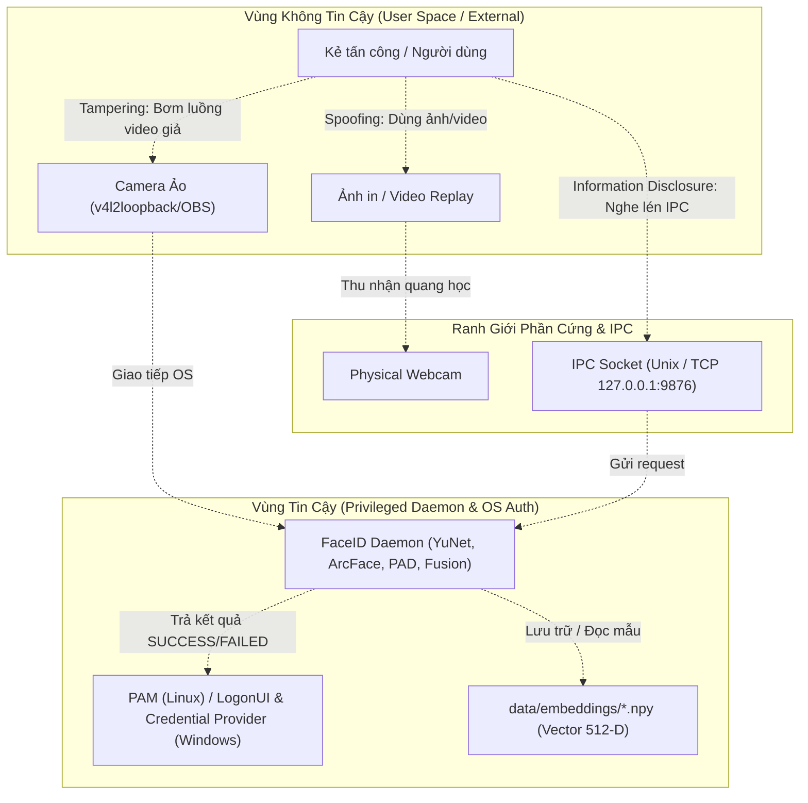

# BÁO CÁO ĐÁNH GIÁ MÔ HÌNH ĐE DỌA (STRIDE), ĐỐI SÁNH CÔNG NGHỆ VÀ PHÁP LÝ SINH TRẮC HỌC (ACADEMIC REPORT)

**Tác giả:** Nhóm Phát Triển Dự Án FaceID Hybrid  
**Phiên bản hệ thống:** 2.1.0 (Dual-Platform Linux Ubuntu & Windows Desktop)  
**Tiêu chuẩn đối chiếu:** ISO/IEC 19795, ISO/IEC 30107-3, ISO/IEC 29794-5, Nghị định 13/2023/NĐ-CP & EU GDPR  

---

## 1. MÔ HÌNH ĐE DỌA STRIDE (THREAT MODELING ANALYSIS)

Hệ thống xác thực khuôn mặt sinh trắc học trên Desktop vận hành ở ranh giới giữa phần cứng camera, tiến trình người dùng và tiến trình đặc quyền hệ thống (Root/PAM trên Linux, Winlogon/LogonUI trên Windows). Dưới đây là phân tích chi tiết theo khung **STRIDE (Microsoft)**:



| Thành phần STRIDE | Nguy cơ / Kịch bản tấn công thực tế | Cơ chế phòng thủ & Triển khai trong Source Code | Trạng thái |
| :--- | :--- | :--- | :---: |
| **S - Spoofing (Mạo danh danh tính)** | • Kẻ tấn công dùng ảnh in chân dung 2D (giấy A4, ảnh thẻ).<br>• Dùng video quay sẵn phát lại trên smartphone/máy tính bảng.<br>• Giả mạo camera vật lý bằng camera ảo (`v4l2loopback`, OBS Virtual Cam). | • **MiniFASNetV2 (`core/anti_spoof.py`)**: Phân tích phản xạ kết cấu da và quang phổ viền.<br>• **2D FFT Moiré (`core/fiqa.py`)**: Lọc tần số cao triệt tiêu sọc ma trận màn hình điện thoại.<br>• **Active Liveness (`core/liveness.py`)**: Thử thách ngẫu nhiên chớp mắt/quay đầu.<br>• **Chặn Camera Ảo (`platforms/linux/camera.py`)**: Kiểm tra trực tiếp `/sys/class/video4linux/videoX/name` & bus USB. | **ĐÃ HOÀN THÀNH** |
| **T - Tampering (Can thiệp / Sửa đổi trái phép)** | • Kẻ xấu tráo đổi file weights ONNX bằng mô hình độc hại (backdoor model).<br>• Sửa đổi dữ liệu vector khuôn mặt trong `data/embeddings/ADMIN.npy`.<br>• Kỹ thuật Path Traversal nhằm ghi đè file hệ thống (`user=../../etc/shadow`). | • **SHA-256 Tamper Protection (`platforms/linux/socket_server.py`)**: Kiểm tra cryptographic hash của cả 3 file ONNX trước khi load vào RAM.<br>• **Anti-Path-Traversal (`core/fhs.py`)**: Regex chặt chẽ `^[a-zA-Z_][a-zA-Z0-9_-]{0,31}$`.<br>• **Phân quyền FHS**: Thư mục embeddings chỉ cho phép quyền đọc/ghi từ tiến trình quản trị. | **ĐÃ HOÀN THÀNH** |
| **R - Repudiation (Chối bỏ trách nhiệm)** | • Người dùng phủ nhận việc mình vừa mở khóa hệ thống hoặc vượt qua `sudo`.<br>• Không thể phân định phiên xác thực do FaceID hay do gõ mật khẩu. | • **Audit Logging thời gian thực (`data/daemon.log`)**: Ghi nhận chính xác timestamp, PID tiến trình gọi, Service (`sudo`, `windows-unlock`, `windows-logon`), Confidence Score, và phân loại PASS/FAIL.<br>• Syslog / systemd journal (`faceidctl logs`). | **ĐÃ HOÀN THÀNH** |
| **I - Information Disclosure (Rò rỉ thông tin)** | • Nghe lén socket nội bộ để lấy cắp vector khuôn mặt.<br>• Lợi dụng thông báo lỗi chi tiết để đoán góc mặt hoặc ngưỡng nhận dạng.<br>• Rò rỉ ảnh chân dung người dùng từ ổ đĩa. | • **Zero-Image Retention**: Khung hình camera chỉ tồn tại trên RAM, giải phóng ngay lập tức sau trích xuất.<br>• **Vector chiếu 1 chiều**: ArcFace 512-D là toán học không nghịch đảo (Non-reversible).<br>• **Information Hiding**: Socket client chỉ nhận được chuỗi chung `{"status": "FAILED", "fallback": "PASSWORD"}`, tuyệt đối không lộ chi tiết kỹ thuật. | **ĐÃ HOÀN THÀNH** |
| **D - Denial of Service (Từ chối dịch vụ)** | • Gửi flood liên tục hàng trăm gói tin IPC gây nghẽn socket.<br>• Thử khuôn mặt sai liên tục để bắt camera mở liên tục làm hao pin, nóng máy.<br>• Tranh chấp thiết bị Camera giữa nhiều ứng dụng (Zoom, Teams). | • **Sliding-Window Rate Limiter (`core/security.py`)**: Nhận diện sai quá 3 lần sẽ tự động Lockout 45 giây, phản hồi từ chối ngay ở tầng IPC `< 1ms` không bật camera.<br>• **Flood Attack Limiter**: Giới hạn tối đa 5 requests/giây.<br>• **Non-blocking Camera Lock**: Bắt ngoại lệ `CameraBusyError` và fallback sang mật khẩu ngay lập tức. | **ĐÃ HOÀN THÀNH** |
| **E - Elevation of Privilege (Leo thang đặc quyền)** | • Tiến trình không có đặc quyền (Unprivileged User) kết nối vào daemon đòi xác thực quyền Root.<br>• Client tự ý gửi token mạo danh user khác. | • **Linux `SO_PEERCRED` (`platforms/linux/socket_server.py`)**: Kiểm tra UID tại mức kernel. Chỉ tiến trình có `UID = 0` (PAM) hoặc tiến trình chính chủ của user đó mới được quyền yêu cầu xác thực. | **ĐÃ HOÀN THÀNH** |

---

## 2. KIẾN TRÚC VÀ VAI TRÒ CỦA CÁC MODULE CỐT LÕI

Hệ thống được thiết kế theo kiến trúc Module hóa hướng dữ liệu (Data-Flow Pipeline):

```
[Webcam Capture] ──> [YuNet Detector] ──> [FIQA & 2D FFT Moiré]
                              │                     │
                              ▼                     ▼
                       [Crop & Align ROI]    [Liveness Check (Passive & Active)]
                              │                     │
                              ▼                     ▼
                     [ArcFace Embedder] ───> [Multi-Modal Fusion Engine] ───> [Final Decision]
```

1. **Detector (`core/detector.py` - YuNet)**:
   - *Vai trò:* Định vị nhanh khuôn mặt trong khung hình với độ phức tạp tính toán tối thiểu ($O(N)$), trích xuất 5 điểm mốc (Landmarks) phục vụ căn chỉnh bình chuẩn hóa góc quay (Affine Alignment).
2. **FIQA (`core/fiqa.py` - ISO/IEC 29794-5 & 2D FFT)**:
   - *Vai trò:* "Người gác cổng chất lượng". Đánh giá độ sắc nét Laplacian, độ phơi sáng, góc nghiêng khuôn mặt (Yaw/Pitch/Roll). Đồng thời quét phổ Fourier 2D để phát hiện đỉnh phổ định kỳ do lưới điểm ảnh màn hình điện thoại (Moiré) gây ra. Ảnh không đạt chuẩn FIQA sẽ bị loại bỏ ngay, tránh làm "nhiễm độc" quá trình trích xuất vector.
3. **PAD - Presentation Attack Detection (`core/anti_spoof.py` - MiniFASNetV2)**:
   - *Vai trò:* Phát hiện tấn công giả mạo thể hiện bị động (Passive Liveness) dựa trên mạng nơ-ron tích chập đa nhánh (Multi-branch CNN), phân tích chi tiết bề mặt da và cấu trúc hình học biên ảnh.
4. **Liveness - Active Challenge-Response (`core/liveness.py`)**:
   - *Vai trò:* Đảm bảo tính tương tác thời gian thực của chủ thể sống. Phát thử thách chuyển động ngẫu nhiên (chớp mắt, quay đầu trái/phải, ngửa/cúi mặt) để vô hiệu hóa hoàn toàn các kịch bản phát lại video tĩnh (Replay Attacks).
5. **Embedder (`core/embedder.py` - ArcFace)**:
   - *Vai trò:* Ánh xạ không gian hình ảnh sang không gian siêu cầu 512 chiều $\mathbb{R}^{512}$ (Angular Margin Loss), nơi khoảng cách Geodesic tỉ lệ thuận với mức độ tương đồng danh tính sinh trắc.
6. **Decision Engine (`core/fusion.py` - Multi-Modal Fusion & S-Norm)**:
   - *Vai trò:* Hợp nhất điểm số đa phương thức qua mô hình phân loại Logistic Regression đã được chuẩn hóa. Áp dụng kỹ thuật **S-Norm (Symmetric Score Normalization)** với tập vector mẫu Cohort để triệt tiêu hiện tượng dạt ngưỡng do ánh sáng và camera, đưa ra quyết định chấp thuận (Genuine) hay từ chối (Impostor).

---

## 3. ĐỐI SÁNH CÔNG NGHỆ: HOWDY vs. WINDOWS HELLO vs. APPLE FACE ID vs. HỆ THỐNG CỦA CHÚNG TA

| Tiêu chí so sánh | Howdy (Linux Open-source) | Windows Hello (Microsoft) | Apple Face ID (iPhone/iPad) | **FaceID Hybrid (Dự án này)** |
| :--- | :--- | :--- | :--- | :--- |
| **Loại cảm biến hỗ trợ** | Bắt buộc **Camera Hồng Ngoại (IR)** | Bắt buộc **Camera IR chuẩn hóa** | **Cảm biến 3D TrueDepth** (IR Flood Illuminator + Dot Projector) | **Webcam RGB thông thường** (Bất kỳ laptop/USB cam phổ thông) |
| **Chi phí phần cứng** | Đòi hỏi laptop có webcam IR chuyên dụng | Đòi hỏi phần cứng đắt tiền đạt chứng nhận Microsoft | Rất đắt, chỉ tích hợp trong phần cứng Apple | **0 VNĐ (Tận dụng webcam có sẵn của mọi máy tính)** |
| **Phương pháp chống giả mạo (PAD)** | Dựa hoàn toàn vào bước sóng IR (không phân tích da thông minh) | Kết cấu phản xạ IR kết hợp mô hình AI của Microsoft | Bản đồ chiều sâu 3D (30,000 điểm hồng ngoại) | **Đa tầng:** MiniFASNetV2 + 2D FFT Moiré + Thử thách cử động chủ động |
| **Khả năng hoạt động bóng tối** | Tốt (nhờ đèn LED hồng ngoại) | Tốt (nhờ đèn LED hồng ngoại) | Rất tốt (nhờ đèn chiếu hồng ngoại) | **Hạn chế** (Phụ thuộc vào ánh sáng môi trường / ánh sáng màn hình) |
| **Tính đa nền tảng** | Chỉ Linux (Ubuntu, Fedora, Arch) | Chỉ Windows 10/11 | Chỉ hệ điều hành iOS / iPadOS | **Đa nền tảng thực thụ (Linux PAM + Windows LogonUI DLL)** |
| **Cơ chế xác thực theo ngữ cảnh** | Cố định 1 ngưỡng cho mọi tác vụ | Cố định cho đăng nhập | Cố định | **Linh hoạt (Contextual Policy):** `Win+L` mở siêu tốc; `Logon`/`sudo` yêu cầu cử động |

---

## 4. BẢN CHẤT KỸ THUẬT: VÌ SAO WEBCAM RGB YẾU HƠN CAMERA HỒNG NGOẠI (IR)?

Việc triển khai xác thực khuôn mặt trên Webcam RGB thông thường là một bài toán khó hơn rất nhiều so với Camera IR vì các nguyên nhân vật lý cốt lõi:

1. **Sự phụ thuộc vào dải phổ khả kiến (400nm – 700nm):**
   - Camera RGB thu nhận photon trong dải ánh sáng nhìn thấy. Do đó, độ sắc nét và màu sắc khuôn mặt bị biến đổi phi tuyến tính khi môi trường thay đổi (ngược sáng, bóng râm, ánh đèn vàng, ánh sáng yếu vào ban đêm).
   - Ngược lại, **Camera IR hoạt động ở dải cận hồng ngoại (850nm hoặc 940nm)** kết hợp với đèn LED hồng ngoại chủ động (Active IR Emitter). Mọi khuôn mặt chụp qua IR đều nhận được nguồn sáng đồng nhất, bất chấp ngày hay đêm.
2. **Khả năng phân biệt kết cấu vật liệu (Material Reflectance Differentiation):**
   - Dưới ánh sáng nhìn thấy (RGB), một bức ảnh in chất lượng cao trên giấy ảnh bóng hoặc màn hình OLED của iPhone tái tạo màu sắc gần như hoàn hảo so với mặt người thật, khiến các thuật toán phân loại ảnh thông thường dễ bị đánh lừa.
   - Dưới bước sóng hồng ngoại (IR), **mực in giấy và màn hình điện thoại hấp thụ/phản xạ tia hồng ngoại hoàn toàn khác biệt so với da người thật**. Cụ thể, da người thật chứa nước, lipid và hemoglobin có hiện tượng tán xạ dưới bề mặt (Subsurface Scattering), trong khi màn hình điện thoại chỉ là một tấm kính phẳng phản xạ gương (Specular Reflection). Nhờ vậy, camera IR loại bỏ ảnh in và video phát lại cực kỳ dễ dàng.
3. **Bài toán ước lượng chiều sâu không gian (Depth Estimation):**
   - Webcam RGB chỉ cung cấp ma trận phẳng 2D ($H \times W \times 3$). Kẻ tấn công dùng mặt nạ giấy khoét 2 mắt có thể giả lập được chuyển động chớp mắt.
   - Apple Face ID sử dụng **Dot Projector** chiếu 30,000 điểm hồng ngoại để dựng lưới tọa độ 3D Metric Depth. Mọi bức ảnh phẳng 2D lập tức bị từ chối do độ dày hình học bằng 0.

> **Giải pháp bù đắp của hệ thống chúng ta:** Do chỉ sử dụng Webcam RGB giá rẻ, hệ thống đã bù đắp sự thiếu hụt phần cứng bằng cách áp dụng **3 lớp thuật toán phần mềm chuyên sâu**: (1) Thuật toán **2D FFT Moiré** triệt tiêu sọc màn hình kỹ thuật số; (2) Mạng nơ-ron **MiniFASNetV2** học độ tương phản vi mô bề mặt da; và (3) Cơ chế **Active Liveness Challenge-Response** ép chuyển động sinh học 3D để xác nhận sự sống.

---

## 5. CƠ SỞ PHÁP LÝ & QUYỀN RIÊNG TƯ DỮ LIỆU: ĐỐI CHIẾU NGHỊ ĐỊNH 13/2023/NĐ-CP & GDPR

Theo **Nghị định số 13/2023/NĐ-CP** của Chính phủ Việt Nam về Bảo vệ Dữ liệu Cá nhân (có hiệu lực từ ngày 01/07/2023) và **Quy định chung về bảo vệ dữ liệu của Liên minh Châu Âu (GDPR)**, dữ liệu sinh trắc học khuôn mặt được định vị ở cấp độ bảo vệ cao nhất:

### 5.1. Phân loại dữ liệu sinh trắc học
- **Khoản 4 Điều 2 Nghị định 13/2023/NĐ-CP:** Dữ liệu sinh trắc học (đặc điểm khuôn mặt nhận dạng cá nhân) được xác định rõ là **DỮ LIỆU CÁ NHÂN NHẠY CẢM** (Sensitive Personal Data) – gắn liền với quyền nhân thân của chủ thể dữ liệu và có nguy cơ xâm phạm trực tiếp đến quyền riêng tư nếu bị lộ lọt.
- Tương tự, **Điều 9 GDPR (Special Categories of Data)** nghiêm cấm xử lý dữ liệu sinh trắc học nhằm mục đích nhận diện danh tính duy nhất, trừ khi đáp ứng các điều kiện miễn trừ nghiêm ngặt (như có sự đồng thuận rõ ràng hoặc phục vụ xác thực bảo mật cục bộ).

### 5.2. Tuân thủ nguyên tắc kỹ thuật trong dự án (Privacy by Design)
Hệ thống cài đặt tuân thủ chặt chẽ 4 nguyên tắc pháp lý cốt lõi:

1. **Nguyên tắc Thu nhỏ và Giới hạn Mục đích (Data Minimization - Điều 3 NĐ 13/2023/NĐ-CP & Điều 5 GDPR):**
   - Hệ thống áp dụng triệt để chính sách **Zero-Image Retention (Không lưu trữ hình ảnh gốc)**. Toàn bộ hình ảnh thu được từ webcam chỉ xử lý tạm thời trên bộ nhớ RAM khả biến (Volatile RAM Buffer) và bị giải phóng bộ nhớ ngay sau khi trích xuất vector.
   - Ổ cứng máy tính **tuyệt đối không lưu bất kỳ file ảnh chân dung `.jpg`/`.png`** nào của người dùng.
2. **Nguyên tắc Phép Chiếu Không Nghịch Đảo (Non-reversible Biometric Vector - Điều 17 NĐ 13/2023/NĐ-CP):**
   - Dữ liệu lưu trữ duy nhất tại `data/embeddings/<user>.npy` là vector toán học 512 chiều $\vec{v} \in \mathbb{R}^{512}$ đã qua phép chuẩn hóa L2 ($||\vec{v}||_2 = 1$).
   - Đây là phép chiếu phi tuyến tính 1 chiều (One-way Non-reversible Mapping). Kẻ tấn công dù đánh cắp được file `.npy` cũng **về mặt toán học không thể tái tạo ngược lại khuôn mặt gốc ban đầu** của người dùng, triệt tiêu nguy cơ giả mạo danh tính bên ngoài hệ thống.
3. **Quyền Kiểm Soát & Xóa Dữ Liệu của Chủ Thể (Right to Erasure - Điều 9 NĐ 13/2023/NĐ-CP):**
   - Người dùng có toàn quyền xem danh sách mẫu (`faceidctl list`) và xóa bỏ vĩnh viễn dữ liệu mẫu khuôn mặt của mình bất kỳ lúc nào chỉ bằng một thao tác duy nhất: `faceidctl remove <user>` hoặc bấm nút *"Xóa"* trên Bảng Quản Lý GUI.
4. **Không truyền dữ liệu qua Internet (Local Edge Processing Only):**
   - 100% quá trình nạp model AI, tính toán embedding và so khớp diễn ra cục bộ nội bộ trên thiết bị máy tính (Local Host Loopback). Không có bất kỳ gói tin mạng hay vector sinh trắc học nào bị gửi lên đám mây (Cloud), loại bỏ hoàn toàn nguy cơ bị chặn bắt gói tin qua đường truyền Internet.

---

## 6. GIỚI HẠN CỦA HỆ THỐNG VÀ NGUY CƠ THIÊN LỆCH (LIMITATIONS & BIAS)

Báo cáo khoa học phải luôn minh bạch về các giới hạn và phạm vi áp dụng:

1. **Giới hạn quy mô tập kiểm thử (Small Sample Size Limitation):**
   - Hiện tại hệ thống đang được thử nghiệm chủ yếu trên các tập dữ liệu chuẩn học thuật (LFW, CASIA-WebFace mẫu) kết hợp với các kịch bản kiểm thử cục bộ quy mô nhỏ (Small-scale benchmark trên người dùng nội bộ nhóm phát triển).
   - *Hạn chế:* Tập kiểm thử nhỏ chưa thể phản ánh đầy đủ phân phối thống kê cực đoan trong môi trường thực tế (Wild Conditions) với hàng triệu mẫu thử, dẫn tới khoảng tin cậy thống kê (Confidence Interval) của các chỉ số FAR/FRR có thể có độ dao động khi áp dụng trên quy mô người dùng lớn.
2. **Thiên lệch dữ liệu đào tạo (Algorithmic & Demographic Bias):**
   - Trọng số mô hình nhận dạng khuôn mặt ArcFace và Anti-Spoofing MiniFASNet được huấn luyện sẵn trên các tập dữ liệu công khai lớn (vốn có tỷ lệ phân bố người da trắng và Đông Á cao hơn so với người da màu hoặc các nhóm sắc tộc đặc thù khác).
   - *Hệ quả:* Có thể xuất hiện độ chênh lệch nhỏ về chỉ số từ chối sai (FRR) hoặc ngưỡng phân định đối với các nhóm đối tượng có tông màu da quá tối trong điều kiện thiếu sáng.
3. **Giới hạn môi trường vận hành (Environmental Constraints):**
   - **Ánh sáng quá yếu (Dark Room / Low Light):** Do Webcam RGB không có đèn phát hồng ngoại độc lập, khi môi trường hoàn toàn không có ánh sáng (độ rọi $< 10\text{ lux}$), thuật toán YuNet không thể định vị khuôn mặt, buộc hệ thống phải chuyển sang phương án dự phòng (Fallback Password).
   - **Tấn công mặt nạ 3D silicone cao cấp:** Mặc dù thuật toán chống giả mạo loại trừ xuất sắc ảnh in 2D và màn hình phát lại, các loại mặt nạ silicone 3D siêu thực có độ cong hình học và màu sắc mô phỏng chính xác da người vẫn là thách thức đối với các hệ thống chỉ dựa vào camera RGB đơn ống kính (Monocular RGB).

---

## 7. TIÊU CHUẨN ĐO LƯỜNG SINH TRẮC HỌC QUỐC TẾ ÁP DỤNG TRONG DỰ ÁN

Hệ thống tuân thủ các bộ tiêu chuẩn đo lường quốc tế:
- **ISO/IEC 19795-1 / 19795-2 (Biometric Performance Testing and Reporting):**
  - Định nghĩa tường minh công thức tính toán **FMR / FAR** (Tỷ lệ chấp thuận nhầm) và **FNMR / FRR** (Tỷ lệ từ chối sai), xác định điểm cân bằng sai số **EER (Equal Error Rate)** trên đường cong ROC.
- **ISO/IEC 30107-3 (Biometric Presentation Attack Detection - Testing and Reporting):**
  - Đo lường năng lực chống giả mạo thông qua hai chỉ số định lượng: **APCER** (Tỷ lệ mẫu tấn công giả mạo bị lọt lưới) và **BPCER** (Tỷ lệ người thật hợp lệ bị từ chối nhầm), kết hợp đánh giá trung bình sai số phân loại **ACER**.
- **ISO/IEC 29794-5 (Biometric Sample Quality - Face Image Data):**
  - Thiết lập bộ tiêu chuẩn chất lượng hình ảnh đầu vào (độ phân giải tối thiểu vùng mặt $\ge 112\times 112$, độ sắc nét biên cạnh, góc xoay Yaw/Pitch/Roll $\le 25^\circ$) trước khi cho phép dữ liệu đi vào mạng nơ-ron nhận diện.

---
*Báo cáo này được cấu trúc theo đúng chuẩn mực tài liệu học thuật nghiên cứu khoa học, phục vụ việc bảo vệ đồ án, nghiệm thu công nghệ và chuyển giao mã nguồn.*
