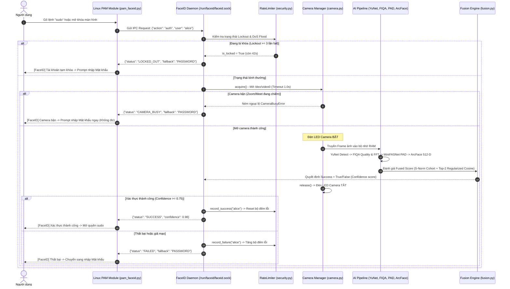

# TÀI LIỆU KIẾN TRÚC HỆ THỐNG VÀ DANH MỤC MÃ NGUỒN (CODEBASE REFERENCE)
**Dự án:** FaceID Hybrid Authentication System (Linux PAM / Ubuntu 24.04 LTS)  
**Phiên bản:** 2.0.0 (Cập nhật: 2026-10-16)

---

## 1. TỔNG QUAN CÂY THƯ MỤC DỰ ÁN

```text
faceid-auth-desktop/
├── config/                         # Thư mục cấu hình hệ thống
│   ├── config.json                 # Cấu hình phần cứng camera, đường dẫn model ONNX
│   ├── fusion_model.json           # Trọng số và ngưỡng Logistic Regression sau huấn luyện
│   └── policy.json                 # Chính sách Rate Limiting, Quyền riêng tư & mục tiêu PAM
├── core/                           # Tầng giải thuật AI & Logic an ninh cốt lõi
│   ├── __init__.py
│   ├── detector.py                 # YuNet: Phát hiện khuôn mặt & 5 điểm mốc (landmarks)
│   ├── fiqa.py                     # FIQA & 2D FFT Moiré: Đánh giá chất lượng & phát hiện màn hình
│   ├── anti_spoof.py               # MiniFASNet v2: Passive Anti-Spoofing (PAD)
│   ├── embedder.py                 # ArcFace: Trích xuất vector đặc trưng 512 chiều
│   ├── liveness.py                 # Active Challenge-Response: Kiểm tra cử động chủ động
│   ├── fusion.py                   # MultiModalFusionEngine: Chuẩn hóa S-Norm & Hợp nhất đa phương thức
│   └── security.py                 # RateLimiter: Chống vét cạn (Lockout) & Chống DoS Socket
├── data/                           # Dữ liệu phục vụ nhận dạng & chuẩn hóa
│   ├── cohort_lfw.npy              # 128 vector đặc trưng khuôn mặt thật trích xuất từ dataset LFW
│   ├── datasets/                   # Thư mục chứa dataset thử nghiệm (LFW)
│   └── embeddings/                 # Lưu trữ vector khuôn mặt đã đăng ký (user.npy)
├── eval/                           # Đánh giá & Huấn luyện
│   ├── benchmark.py                # Kịch bản benchmark thời gian và hiệu năng
│   ├── metrics.py                  # Công cụ tính FAR, FRR, EER, APCER, BPCER (ISO/IEC)
│   ├── roc_curve.png               # Biểu đồ ROC đường cong hiệu năng học thuật
│   └── train_fusion.py             # Script huấn luyện trọng số Logistic Regression (5-Fold CV)
├── models/                         # Các mô hình học sâu định dạng ONNX
│   ├── face_detection_yunet.onnx   # Model YuNet (phát hiện mặt)
│   ├── minifasnet_v2.onnx          # Model MiniFASNet v2 (chống giả mạo passive)
│   └── arcface.onnx                # Model ArcFace (nhận diện danh tính)
├── platforms/                      # Tầng tích hợp hệ điều hành
│   ├── linux/
│   │   ├── camera.py               # LinuxCameraManager: Quản lý V4L2, chống treo Terminal
│   │   ├── pam_faceid.py           # Module PAM tích hợp với Linux PAM Stack (/etc/pam.d/)
│   │   ├── socket_server.py        # FaceIDDaemon: Unix Domain Socket Server chạy ngầm
│   │   └── service/
│   │       └── faceid-auth.service # File cấu hình systemd service cho Ubuntu 24.04
│   └── windows/
│       └── camera_win.py           # Quản lý camera trên Windows (DirectShow) phục vụ kiểm thử
├── scripts/                        # Các công cụ dòng lệnh (CLI Scripts)
│   ├── build_cohort.py             # Trích xuất 128 vector LFW tạo cohort_lfw.npy
│   ├── enroll.py                   # Đăng ký khuôn mặt 5 tư thế chuẩn (Hands-Free)
│   ├── faceidctl                   # Công cụ CLI quản trị FaceID (tương tự fprintd/howdy)
│   └── verify_interactive.py       # Script kiểm thử xác thực 1:1 trực quan có giao diện OpenCV
├── daemon.py                       # File thực thi khởi chạy FaceID Daemon
└── requirements.txt                # Danh sách thư viện phụ thuộc Python
```

---

## 2. SƠ ĐỒ LUỒNG DỮ LIỆU ĐẦU-CUỐI (END-TO-END DATAFLOW)



---

## 3. DANH MỤC CHI TIẾT TỪNG MODULE VÀ BẢNG TRA CỨU HÀM

### 3.1. Tầng AI Cốt Lõi (`core/`)

#### 📄 `core/detector.py` — Phát hiện khuôn mặt YuNet
- **Mục đích:** Phát hiện khuôn mặt và định vị chính xác 5 điểm mốc hình học (Landmarks).
- **Class:** `YuNetDetector`
  - `__init__(model_path, conf_threshold=0.75, nms_threshold=0.3, input_size=(320, 320))`
  - `detect(frame_bgr: np.ndarray) -> list[tuple[box, landmarks, score]]`
    - **Input:** Khung hình ảnh BGR từ OpenCV (kích thước bất kỳ).
    - **Output:** Danh sách các khuôn mặt tìm thấy:
      - `box`: Tuple `(top, right, bottom, left)` dạng số nguyên tọa độ pixel.
      - `landmarks`: Mảng NumPy `(5, 2)` chứa tọa độ 5 điểm mốc (mắt phải, mắt trái, chóp mũi, mép miệng phải, mép miệng trái).
      - `score`: Điểm tin cậy phát hiện khuôn mặt `float` $\in [0.0, 1.0]$.

#### 📄 `core/fiqa.py` — Đánh giá chất lượng khuôn mặt & Phát hiện vân Moiré
- **Mục đích:** Kiểm tra ảnh có đủ chuẩn để nhận diện không (độ nét, ánh sáng, góc nghiêng 3D) và phát hiện vân pixel màn hình điện thoại bằng phổ thích ứng 2D FFT.
- **Class:** `FaceQualityAssessor`
  - `detect_moire_fft(face_roi_gray: np.ndarray) -> float`
    - **Mục đích:** Sử dụng **Adaptive Spectral Peak Detection (MSP)** kết hợp cửa sổ Hanning và khử trục chữ thập để phát hiện màn hình điện thoại/máy tính bảng.
    - **Output:** `moire_score` $\in [0.0, 1.0]$ (càng cao càng nghi vấn màn hình giả mạo).
  - `calculate_sharpness(gray_roi: np.ndarray) -> float`
    - **Mục đích:** Tính phương sai toán tử Laplace ($Var(\Delta I)$) để đo độ mờ/nét.
  - `calculate_brightness(gray_roi: np.ndarray) -> float`
    - **Mục đích:** Tính giá trị trung bình mức xám của vùng da mặt để phát hiện quá tối / quá chói.
  - `estimate_pose(landmarks, frame_w, frame_h) -> tuple[yaw, pitch, roll]`
    - **Mục đích:** Ước lượng góc xoay 3 chiều của đầu dựa trên tỷ lệ hình học 5 điểm mốc.
  - `evaluate_quality(frame_bgr, box, landmarks) -> QualityMetrics`
    - **Mục đích:** Đánh giá tổng thể chất lượng ảnh; trả về dataclass `QualityMetrics` gồm `passed`, `is_live_fft`, `sharpness`, `brightness`, `moire_score`, `yaw`, `pitch`, `roll`, `reason`.

#### 📄 `core/anti_spoof.py` — Chống giả mạo thụ động MiniFASNet v2 (PAD)
- **Mục đích:** Phân loại khuôn mặt thật (Bona Fide) so với ảnh in (Print Attack) hoặc màn hình (Replay Attack) mà không cần người dùng cử động.
- **Class:** `MiniFASNetDetector`
  - `predict(frame_bgr, box) -> tuple[is_real: bool, real_score: float]`
    - **Input:** Ảnh gốc và tọa độ khuôn mặt.
    - **Output:** Trả về xác suất mặt thật `real_score` $\in [0.0, 1.0]$.
  - `predict_smoothed(frame_bgr, box) -> tuple[is_real: bool, smoothed_score: float, raw_score: float]`
    - **Mục đích:** Áp dụng bộ lọc làm mịn thời gian số mũ (Exponential Smoothing: $\alpha = 0.65$) để điểm số ổn định, tránh nhấp nháy giữa các frame liên tiếp.

#### 📄 `core/embedder.py` — Trích xuất đặc trưng ArcFace
- **Mục đích:** Biến đổi khuôn mặt thành vector 512 chiều trên không gian siêu cầu $\mathbb{S}^{511}$.
- **Class:** `ArcFaceEmbedder`
  - `align_face(frame_bgr, landmarks) -> np.ndarray`
    - **Mục đích:** Sử dụng phép biến đổi tương đồng Affine (Similarity Transform) để xoay và căn chỉnh 2 mắt nằm ngang, chóp mũi ở giữa khung hình $112 \times 112$.
  - `extract(frame_bgr, box, landmarks=None) -> np.ndarray`
    - **Output:** Vector đặc trưng chuẩn hóa $L_2$ kích thước `(512,)` kiểu `float32`.
  - `compute_distance(emb1, emb2) -> float`
    - **Mục đích:** Tính khoảng cách Cosine: $D_{\cos} = 1 - \langle e_1, e_2 \rangle \in [0.0, 2.0]$.

#### 📄 `core/liveness.py` — Thử thách chủ động (Active Challenge-Response)
- **Mục đích:** Đòi hỏi người dùng thực hiện một hành động ngẫu nhiên để chống giả mạo video quay sẵn hoặc mặt nạ silicon tĩnh.
- **Enum:** `ActionType` (`HEAD_LEFT`, `HEAD_RIGHT`, `HEAD_UP`, `HEAD_DOWN`, `TWO_FINGERS`).
- **Class:** `ChallengeResponseDetector`
  - `reset_challenge(exclude_action=None) -> ActionType`
    - **Mục đích:** Chọn ngẫu nhiên một thử thách mới khi bắt đầu phiên.
  - `check_action(frame_bgr, pose, landmarks, face_box) -> tuple[passed: bool, hint: str, debug_info: dict]`
    - **Mục đích:** Kiểm tra xem tư thế người dùng đã thỏa mãn thử thách hiện tại chưa (yêu cầu nghiêm ngặt `face_box is not None` khi phát hiện ngón tay).

#### 📄 `core/fusion.py` — Chuẩn hóa S-Norm & Hợp nhất đa phương thức
- **Mục đích:** Chuẩn hóa điểm Cosine chống hiện tượng Doddington's Zoo và tổng hợp đa chỉ số thành một quyết định duy nhất.
- **Class:** `MultiModalFusionEngine`
  - `compute_snorm(probe_emb, template_emb, raw_sim) -> float`
    - **Mục đích:** Tính toán Symmetric Score Normalization (S-Norm) dựa trên 128 vector mặt thật từ `data/cohort_lfw.npy`.
  - `evaluate_fused(...) -> FusionDecision`
    - **Mục đích:** Đưa 4 đặc trưng đã chuẩn hóa qua hàm Logistic Regression (đã fit trọng số) để xuất xác suất hợp nhất `confidence_score` $\in [0.0, 1.0]$.
    - **Output:** Dataclass `FusionDecision` gồm `success: bool`, `confidence_score: float`, `snorm_similarity`, `passive_score`, `active_passed`, `details`.

#### 📄 `core/security.py` — Chống vét cạn & Chống DoS Socket
- **Mục đích:** Bảo vệ hệ thống trước tấn công Brute-force mật khẩu/mặt và DoS flood IPC socket.
- **Class:** `RateLimiter`
  - `check_flood_attack() -> bool`
    - **Mục đích:** Kiểm tra nếu có $> 5$ request/giây tới socket thì đánh dấu flood.
  - `get_lockout_status(user: str) -> LockoutStatus`
    - **Mục đích:** Kiểm tra tài khoản người dùng có đang bị khóa FaceID tạm thời không.
  - `record_failure(user: str) -> LockoutStatus`
    - **Mục đích:** Ghi nhận 1 lần xác thực thất bại. Nếu đạt 3 lần, kích hoạt khóa tài khoản 45 giây.
  - `record_success(user: str) -> None`
    - **Mục đích:** Reset bộ đếm lỗi về 0 ngay khi người dùng xác thực thành công.

---

### 3.2. Tầng Vận Hành Hệ Thống & Linux PAM (`platforms/linux/`)

#### 📄 `platforms/linux/camera.py` — Quản lý Camera V4L2 chống treo Terminal
- **Class:** `LinuxCameraManager`
  - `is_device_available() -> bool`
    - **Mục đích:** Kiểm tra quyền đọc/ghi trên `/dev/video0`.
  - `acquire() -> Generator[cv2.VideoCapture, None, None]` (Context Manager)
    - **Mục đích:** Mở camera với cơ chế non-blocking timeout $\le 1.0\text{s}$. Nếu camera đang bị Zoom/Meet chiếm dụng, lập tức ném `CameraBusyError`. Khi thoát khỏi khối lệnh (`with`), lập tức gọi `cap.release()` để tắt đèn LED camera.

#### 📄 `platforms/linux/socket_server.py` — Unix Domain Socket Daemon
- **Class:** `FaceIDDaemon`
  - `authenticate_user(user: str, service: str) -> dict`
    - **Mục đích:** Chạy chu trình xác thực đầy đủ cho một user; xử lý RateLimiter, tải template, mở camera và gọi AI Pipeline.
  - `handle_client(conn: socket.socket) -> None`
    - **Mục đích:** Xử lý gói tin JSON nhận từ PAM module.
  - `start() / stop()`: Khởi chạy và dừng Socket Server tại `/run/faceid/faceid.sock`.

#### 📄 `platforms/linux/pam_faceid.py` — Linux PAM Module
- **Hàm chuẩn Linux PAM:**
  - `pam_sm_authenticate(pamh, flags, argv) -> int`: Hàm được Linux PAM gọi khi người dùng thực hiện `sudo`, mở màn hình đăng nhập GDM hoặc screensaver. Trả về:
    - `PAM_SUCCESS (0)`: Khuôn mặt hợp lệ.
    - `PAM_AUTHINFO_UNAVAIL (9)`: Camera bận hoặc user bị lockout $\implies$ PAM lập tức chuyển sang hỏi mật khẩu mà không làm treo terminal.
    - `PAM_AUTH_ERR (7)`: Khuôn mặt sai hoặc gian lận sinh trắc học.

---

### 3.3. Tầng Kịch Bản Công Cụ & Đo Lường (`scripts/` & `eval/`)

- **`scripts/enroll.py`:**
  - `consolidate_templates_to_k_prototypes(vectors, k=5)`: Áp dụng thuật toán **Spherical K-Means** để gom cụm toàn bộ vector chụp được về đúng 5 cụm đại diện cho 5 tư thế (`THANG`, `TRAI`, `PHAI`, `NGUOC`, `CUI`).
  - `load_user_templates(username)`: Nạp mảng 5 vector prototype từ file `.npy`.
- **`scripts/faceidctl`:**
  - `enroll <user>`: Đăng ký khuôn mặt mới.
  - `verify <user>`: Kiểm thử nhận diện tương tác 1:1.
  - `list`: Xem danh sách tài khoản đã đăng ký.
  - `remove <user>`: Xóa dữ liệu mẫu của một tài khoản.
  - `status`: Kiểm tra daemon chạy nền và camera.
- **`eval/metrics.py`:**
  - `compute_far_frr_eer(genuine_scores, imposter_scores)`: Tính điểm giao thoa EER (Equal Error Rate) và chỉ số AUC.
  - `compute_pad_metrics(bona_fide_scores, attack_scores)`: Tính APCER, BPCER và ACER theo chuẩn ISO/IEC 30107-3.
