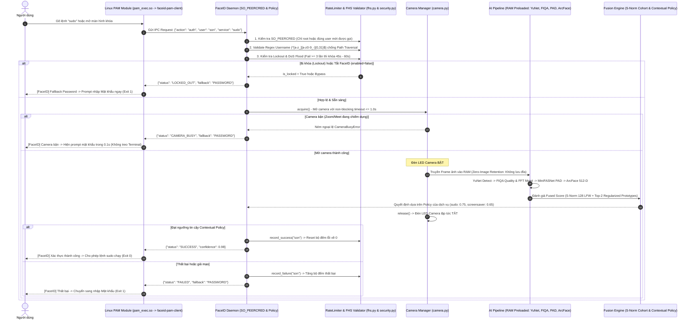

# TÀI LIỆU KIẾN TRÚC HỆ THỐNG VÀ DANH MỤC MÃ NGUỒN (CODEBASE REFERENCE)
**Dự án:** FaceID Hybrid Authentication System (Linux PAM / Ubuntu 24.04 LTS & Windows Dev)  
**Phiên bản:** 2.1.0 (Cập nhật: 2026-10-17)

---

## 1. TỔNG QUAN CÂY THƯ MỤC DỰ ÁN

```text
faceid-auth-desktop/
├── config/                         # Thư mục cấu hình hệ thống
│   ├── config.json                 # Cấu hình On/Off, chế độ Dual-Platform, hash SHA-256 của models
│   ├── fusion_model.json           # Trọng số và ngưỡng Logistic Regression sau huấn luyện
│   └── policy.json                 # Chính sách riêng theo ngữ cảnh PAM (sudo, screensaver, gdm)
├── core/                           # Tầng giải thuật AI & Logic an ninh cốt lõi
│   ├── __init__.py
│   ├── detector.py                 # YuNet: Phát hiện khuôn mặt & 5 điểm mốc (landmarks)
│   ├── fiqa.py                     # FIQA & 2D FFT Moiré: Đánh giá chất lượng & phát hiện màn hình
│   ├── anti_spoof.py               # MiniFASNet v2: Passive Anti-Spoofing (PAD)
│   ├── embedder.py                 # ArcFace: Trích xuất vector đặc trưng 512 chiều
│   ├── liveness.py                 # Active Challenge-Response: Kiểm tra cử động chủ động
│   ├── fusion.py                   # MultiModalFusionEngine: Chuẩn hóa S-Norm & Hợp nhất đa phương thức
│   ├── security.py                 # RateLimiter: Chống vét cạn (Lockout) & Chống DoS Socket
│   └── fhs.py                      # POSIX Username Regex & Ánh xạ đường dẫn FHS / Windows Dev
├── data/                           # Dữ liệu phục vụ nhận dạng & chuẩn hóa
│   ├── cohort_lfw.npy              # 128 vector đặc trưng khuôn mặt thật trích xuất từ dataset LFW
│   ├── datasets/                   # Thư mục chứa dataset thử nghiệm (LFW)
│   └── embeddings/                 # Lưu trữ 5 Pose Prototypes khuôn mặt đã đăng ký (user.npy)
├── eval/                           # Đánh giá, Huấn luyện & Đo kiểm An ninh
│   ├── benchmark.py                # Kịch bản benchmark thời gian và hiệu năng
│   ├── fuzz_socket.py              # Kịch bản Fuzz Testing tự động kiểm tra độ bền socket
│   ├── metrics.py                  # Công cụ tính FAR, FRR, EER, APCER, BPCER (chuẩn ISO/IEC)
│   ├── roc_curve.png               # Biểu đồ ROC đường cong hiệu năng học thuật (AUC = 1.0000)
│   └── train_fusion.py             # Script huấn luyện trọng số Logistic Regression (5-Fold CV)
├── models/                         # Các mô hình học sâu định dạng ONNX
│   ├── face_detection_yunet.onnx   # Model YuNet (phát hiện mặt)
│   ├── minifasnet_v2.onnx          # Model MiniFASNet v2 (chống giả mạo passive)
│   └── arcface.onnx                # Model ArcFace (nhận diện danh tính)
├── platforms/                      # Tầng tích hợp hệ điều hành (Dual-Platform)
│   ├── linux/
│   │   ├── camera.py               # LinuxCameraManager: Quản lý V4L2, chống treo Terminal
│   │   ├── pam_faceid.py           # Module PAM tích hợp với Linux PAM Stack (/etc/pam.d/)
│   │   ├── socket_server.py        # FaceIDDaemon: Socket Server (SO_PEERCRED, SHA-256, Contextual)
│   │   └── service/
│   │       ├── faceid-auth.service # Systemd Service file đã Hardening (systemd-analyze SAFE)
│   │       └── faceid.socket       # Systemd Socket Activation unit
│   └── windows/
│       └── camera_win.py           # Quản lý camera trên Windows (DirectShow) phục vụ kiểm thử
├── scripts/                        # Các công cụ dòng lệnh (CLI Scripts)
│   ├── build_cohort.py             # Trích xuất 128 vector LFW tạo cohort_lfw.npy
│   ├── enroll.py                   # Đăng ký 5 Pose Prototypes khuôn mặt (Spherical K-Means)
│   ├── faceid-pam-client           # Client trung gian cho pam_exec.so trên Ubuntu 24.04 (Python 3.12)
│   ├── faceid_pam_client.py        # Module Python client phục vụ test và import
│   ├── faceidctl                   # Công cụ CLI quản trị FaceID (on, off, status, list, verify)
│   └── verify_interactive.py       # Script kiểm thử xác thực 1:1 trực quan có giao diện OpenCV
├── daemon.py                       # File thực thi khởi chạy FaceID Daemon (hỗ trợ bắt SIGINT/SIGTERM)
└── requirements.txt                # Danh sách thư viện phụ thuộc Python
```

---

## 2. SƠ ĐỒ LUỒNG DỮ LIỆU ĐẦU-CUỐI (END-TO-END DATAFLOW)



---

## 3. DANH MỤC CHI TIẾT TỪNG MODULE VÀ BẢNG TRA CỨU HÀM

### 3.1. Tầng AI Cốt Lõi (`core/`)

#### 📄 `core/detector.py` — Phát hiện khuôn mặt YuNet
- **Class:** `YuNetDetector`
  - `detect(frame_bgr: np.ndarray) -> list[tuple[box, landmarks, score]]`
    - **Input:** Khung hình ảnh BGR từ OpenCV.
    - **Output:** Danh sách các khuôn mặt tìm thấy: `box` `(top, right, bottom, left)`, `landmarks` `(5, 2)` (2 mắt, mũi, 2 khóe miệng), `score` $\in [0.0, 1.0]$.

#### 📄 `core/fiqa.py` — Đánh giá chất lượng & Phát hiện vân Moiré
- **Class:** `FaceQualityAssessor`
  - `detect_moire_fft(face_roi_gray: np.ndarray) -> float`: Phân tích phổ biến thiên thích ứng 2D FFT (Adaptive Spectral Peak Detection) kết hợp cửa sổ Hanning và khử trục chữ thập để phát hiện màn hình điện thoại. Trả về `moire_score` $\in [0.0, 1.0]$.
  - `evaluate_quality(frame_bgr, box, landmarks) -> QualityMetrics`: Đánh giá độ nét (Laplacian variance), độ sáng, góc xoay 3D (Yaw, Pitch, Roll). Chuyển FFT Moiré thành **Soft-Indicator** hỗ trợ MiniFASNet chứ không đánh rớt oan (Hard-Reject) người dùng.

#### 📄 `core/anti_spoof.py` — Chống giả mạo thụ động MiniFASNet v2 (PAD)
- **Class:** `MiniFASNetDetector`
  - `predict_smoothed(frame_bgr, box) -> tuple[is_real: bool, smoothed_score: float, raw_score: float]`: Phân loại mặt thật vs ảnh in/màn hình, áp dụng bộ lọc làm mịn thời gian số mũ ($\alpha = 0.65$) chống nhấp nháy giữa các frame.

#### 📄 `core/embedder.py` — Trích xuất đặc trưng ArcFace
- **Class:** `ArcFaceEmbedder`
  - `extract(frame_bgr, box, landmarks) -> np.ndarray`: Căn chỉnh xoay thẳng mặt (Affine Similarity Transform) và trích xuất vector đặc trưng $L_2$ chuẩn hóa 512 chiều trên siêu cầu $\mathbb{S}^{511}$.
  - `compute_distance(emb1, emb2) -> float`: Tính khoảng cách Cosine: $D_{\cos} = 1 - \langle e_1, e_2 \rangle$.

#### 📄 `core/fusion.py` — Chuẩn hóa S-Norm & Hợp nhất đa phương thức
- **Class:** `MultiModalFusionEngine`
  - `compute_snorm(probe_emb, template_emb, raw_sim) -> float`: Tính chuẩn hóa đối xứng S-Norm dựa trên 128 vector mặt thật từ `data/cohort_lfw.npy`, triệt tiêu hiệu ứng Doddington's Zoo.
  - `evaluate_fused(...) -> FusionDecision`: Đưa 4 đặc trưng qua hàm Logistic Regression (đã fit trọng số thực nghiệm 5-Fold CV, AUC=1.0000) để xuất xác suất hợp nhất `confidence_score`. Tôn trọng ngưỡng tùy biến khi caller truyền vào.

#### 📄 `core/security.py` — Chống vét cạn & Chống DoS Socket
- **Class:** `RateLimiter`
  - `record_failure(user: str) -> LockoutStatus`: Ghi nhận 1 lần xác thực thất bại. Nếu đạt 3 lần, tự động khóa tài khoản trong 45s (hoặc 60s theo policy).
  - `record_success(user: str) -> None`: Reset bộ đếm lỗi về 0 ngay khi xác thực thành công.
  - `check_flood_attack() -> bool`: Giới hạn tối đa 5 requests/giây; quá ngưỡng sẽ bị drop ngay lập tức.

#### 📄 `core/fhs.py` — Chuẩn hóa đường dẫn FHS & Chống Path Traversal
- `validate_username(username: str) -> bool`: Kiểm tra username bằng Regex POSIX `^[a-z_][a-z0-9_-]{0,31}$`. Chặn đứng tuyệt đối các chuỗi Path Traversal (`../../etc/passwd`) và Shell Injection.
- `get_fhs_path(sub_path: str, category: str) -> str`: Bộ chuyển đổi thông minh giữa chuẩn Linux FHS (`/etc/faceid`, `/var/lib/faceid`, `/run/faceid`) và thư mục Dev trên Windows.

---

### 3.2. Tầng Tích Hợp Hệ Điều Hành & PAM (`platforms/` & `scripts/`)

#### 📄 `platforms/linux/socket_server.py` — FaceID Daemon Server
- **Class:** `FaceIDDaemon`
  - Nạp sẵn toàn bộ Model AI vào RAM lúc khởi động (thời gian nạp ~0.3s).
  - `_print_startup_banner()`: In banner hiển thị rõ hệ điều hành (`Windows Dev` vs `Ubuntu Linux`), trạng thái công tắc và điểm lắng nghe socket.
  - `_verify_models_integrity()`: Băm SHA-256 kiểm tra tính toàn vẹn của cả 3 file model ONNX chống tấn công tráo model (Backdoor).
  - `handle_client(conn)`: Sử dụng `SO_PEERCRED` trên Linux để kiểm tra PID/UID/GID của client; áp dụng Contextual Policy theo từng service và ẩn chi tiết lỗi (chỉ trả về `FAILED`).

#### 📄 `platforms/linux/camera.py` — Quản lý Camera V4L2 chống treo Terminal
- **Class:** `LinuxCameraManager`
  - Mở camera qua Context Manager `with camera_mgr.acquire() as cap:`.
  - Giới hạn thời gian mở camera $\le 1.0\text{s}$. Nếu camera bận (Zoom/Meet), ném `CameraBusyError` ngay lập tức để PAM chuyển sang hỏi mật khẩu chỉ sau 0.1s, **hoàn toàn không làm đơ Terminal**.
  - Tự động giải phóng camera và tắt đèn LED ngay khi xong việc.

#### 📄 `scripts/faceid-pam-client` & `faceid_pam_client.py` — Client cho `pam_exec.so`
- Client trung gian chuyên dụng cho module `pam_exec.so` trên Ubuntu 24.04 (Python 3.12).
- Nhận biến môi trường `$PAM_USER`, `$PAM_SERVICE`, kết nối socket tới Daemon.
- Trả mã thoát: Exit code `0` (`PAM_SUCCESS`), Exit code `1` (Fallback Password).

#### 📄 `scripts/faceidctl` — CLI Quản Trị Hệ Thống
- `faceidctl on` / `off`: Bật / Tắt FaceID tức thì (khi tắt sẽ fallback mật khẩu 100%).
- `faceidctl status`: Kiểm tra trạng thái OS, Daemon Process và Camera.
- `faceidctl enroll <user>`: Đăng ký khuôn mặt 5 tư thế chuẩn (Spherical K-Means).
- `faceidctl verify <user>`: Kiểm thử nhận diện tương tác 1:1.
- `faceidctl list`: Liệt kê danh sách người dùng đã đăng ký.

---

### 3.3. Tầng Cấu Hình & Đo Kiểm (`config/`, `eval/`, `service/`)

- **`config/config.json`:** Cấu hình tổng quan, công tắc `enabled`, chế độ `standalone_test`, hash SHA-256 của 3 model.
- **`config/policy.json`:** Chính sách riêng theo ngữ cảnh PAM (`sudo`, `su`, `gnome-screensaver`, `gdm-password`).
- **`config/fusion_model.json`:** Trọng số tối ưu Logistic Regression ($W = [7.75, 10.07, 2.92, 4.22]$, $b = -19.21$).
- **`platforms/linux/service/faceid-auth.service`:** Systemd service unit đã hardening toàn diện (`ProtectSystem=strict`, `NoNewPrivileges=true`, `DevicePolicy=closed`, `RestrictAddressFamilies=AF_UNIX AF_NETLINK`).
- **`platforms/linux/service/faceid.socket`:** Systemd socket activation unit tại `/run/faceid/faceid.sock`.
- **`eval/fuzz_socket.py`:** Kịch bản Fuzz Testing tự động kiểm tra độ bền socket (JSON hỏng, Path Traversal, 100KB payload, DoS flood).
- **`eval/metrics.py`:** Bộ công cụ tính toán các chỉ số sinh trắc học chuẩn quốc tế ISO/IEC 19795-1 và ISO/IEC 30107-3 (FAR, FRR, EER, APCER, BPCER, ACER).
